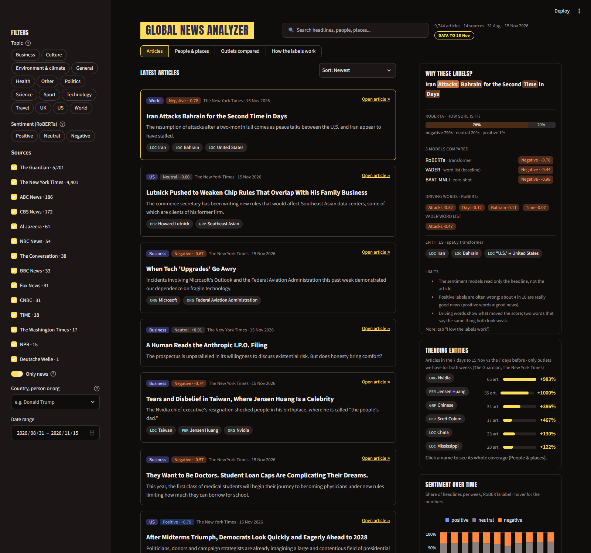

# Global News Analyzer

Collects news from several outlets, labels every headline with its sentiment and the people, places and
organisations it mentions, and shows on a dashboard how coverage and tone differ between outlets and over time.
Every label can be explained on the dashboard ("Why these labels?"). Grouping articles into stories (the same
event in every outlet) was planned but not built: why, in `docs/findings.md`.

Team: Adriana Talavera, Jakub Kabele, Klaudie Polednová, Matylda Smolová, Sára Košelíková
Course: Text Analytics 2, VŠE Prague


More screenshots: `screenshots/`.

## Main results
Hand-labelled evaluation (details and limits: `docs/findings.md`; all numbers: `results/`).

| Task | Approaches compared | Result |
|---|---|---|
| Sentiment of headlines (150 random headlines, our codebook) | VADER (word list, baseline) · RoBERTa · BART-MNLI zero-shot · DistilBERT SST-2 (failure example) · always "neutral" | RoBERTa 71%, VADER 71%, BART 70% (tuned cut-offs), always "neutral" 53%; differences not significant. On 50 headlines labelled by teammates (held out): RoBERTa 58%; two teammates agree with each other on 70%. |
| Driving words ("why this label") | delete a word vs replace it with a mask | masking finds the more important words in 44% of headlines, deleting in 25% |
| Entities (85 names labelled by teammates) | spaCy `en_core_web_sm` vs `en_core_web_trf` | F1 0.68 vs 0.84 (name and type) |

## Where to find what
| Folder / file | Contents |
|---|---|
| `src/collect/` | Data collection: Guardian and NYT APIs, The News API, RSS feeds -> SQLite (`data/raw/news.db`, not in Git) |
| `pipeline/` | NLP pipeline: clean -> sentiment -> explanations -> entities, plus hand-label tools. **How each step works and how to run it: `pipeline/README.md`** |
| `app/` | The dashboard (Streamlit) |
| `data/sample/` | Our hand labels (sentiment, entities) and the codebook |
| `results/` | Metrics tables and plots (index in `results/README.md`) |
| `failures/` | Concrete failure cases (`failures/README.md`) |
| `docs/` | `findings.md` (every finding and limitation, with evidence), `data-sources.md` (terms of use of each outlet), `labelling-guide.md` (guide for the team) |
| `screenshots/` | Dashboard screenshots |
| `archive/` | Earlier versions (first NLP scripts, first plan), not used any more |
| `app.py` | First dashboard demo (Tala), on the outputs of the first version |

## Running the dashboard:
The dashboard can be run independently of the data collection and NLP pipeline. No API keys or model downloads are required.

Due to the data-sharing restrictions of the news outlets, the dashboard data is not included in this repository.

For academic evaluation, please contact a team member to request access to the dashboard data through our university OneDrive.

Put the pipeline outputs (4 CSV files, shared in the team folder) into `data\raw\outputs\`
**Windows:** double-click `run_dashboard.bat`. It installs only streamlit and pandas.
**MacOS:** Python 3.12 recommended. Run following commands in the project folder:
First time setup:
```bash
python3.12 -m venv .venv-dashboard
.venv-dashboard/bin/python -m pip install -r requirements-dashboard.txt
```
Starting the dashboard:
```bash
.venv-dashboard/bin/python -m streamlit run app/streamlit_app.py
```

## Setup
Windows PowerShell, Python 3.11, from the project folder:
```powershell
python -m venv .venv
.venv\Scripts\Activate.ps1
pip install -r requirements.txt
python -m spacy download en_core_web_sm
python -m spacy download en_core_web_trf
Copy-Item .env.example .env
```
Then open `.env` and fill in your API keys (`GUARDIAN_API_KEY`, `NYT_API_KEY`, `THENEWSAPI_API_KEY`). Never commit `.env`.

## Run
```powershell
python src\collect\collect.py              # collect new articles (all sources)
python pipeline\clean.py                   # then the pipeline; each step only does new articles
python pipeline\sentiment.py run
python pipeline\sentiment.py explain
python pipeline\ner.py run
python pipeline\ner.py normalise
streamlit run app\streamlit_app.py         # the dashboard
```


## Data
Raw articles are not published (terms of use of the outlets): `data/raw/` is ignored by Git.
We publish the collection code, the schema (`src/collect/db.py`) and our hand-labelled headlines in `data/sample/`.

## Status
Working towards the prefinal hand-in (26 Nov 2026); the `prefinal` tag will mark that version.
The outlets were collected over different periods, so the dashboard compares each outlet with the Guardian on the
same days (`docs/findings.md`).
